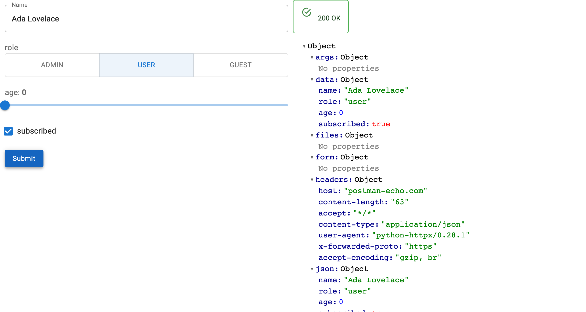

# ✨ panel-openapi

[](https://github.com/panel-extensions/panel-openapi/actions/workflows/ci.yml)
[](https://prefix.dev/channels/conda-forge/packages/panel-openapi)
[](https://pypi.org/project/panel-openapi)
[](https://pypi.org/project/panel-openapi)


**Give it an OpenAPI document, a path and a method, and get a working Panel form:
a widget per parameter, a real HTTP request on submit, and the response
rendered.**

There is no form to write, no request to assemble, and nothing to keep in sync
when the API changes. The schema already says what the inputs are.



## Features

- **No form code** — every path, query, header and body field becomes a widget,
  chosen from its schema: enums become radio buttons or selects, bounded numbers
  become sliders, `format: date` becomes a date picker.
- **Any spec source** — a URL, a plain dict, or a FastAPI app's `api.openapi()`.
  OpenAPI 3.0 and 3.1 both work.
- **Real requests** — submit issues the call with `httpx` and renders the status
  and body. Required fields are enforced from the document.
- **Reactive targeting** — `path`, `method` and `base_url` are parameters, so one
  form can serve any operation in the document.
- **Record editing** — `OpenAPIRecordEditor` loads a record from a `GET` and sends
  the edits to the matching `PATCH`/`PUT`/`POST`. A `PATCH` sends only the fields
  that changed, `readOnly` fields are never sent, and an optional dialog shows the
  diff before anything leaves the browser.
- **Yours to rearrange** — `form` and `response` are plain Panel containers, and
  the introspection helpers (`load_openapi`, `collect_fields`, `schema_to_widget`)
  are public if you would rather build the form yourself.

📖 **[Documentation](https://panel-extensions.github.io/panel-openapi/)** —
[quickstart](https://panel-extensions.github.io/panel-openapi/quickstart/),
how-to guides and API reference.

## Pin your version!

This project is **in its early stages**, so if you find a version that suits your needs, it’s recommended to **pin your version**, as updates may introduce changes.

## Installation

Install it via `pip`:

```bash
pip install panel-openapi
```

## Usage

Point a form at one operation of a document:

```python
import panel as pn

from panel_openapi import OpenAPIForm

pn.extension()

form = OpenAPIForm(
    "https://petstore3.swagger.io/api/v3/openapi.json",
    base_url="https://petstore3.swagger.io/api/v3",
    path="/pet/{petId}",
    method="get",
)

form.servable()
```

```bash
panel serve app.py --show
```

Or load a record and edit it, sending only what changed:

```python
from panel_openapi import OpenAPIRecordEditor

editor = OpenAPIRecordEditor(
    spec,
    base_url="https://api.example.com",
    path="/articles/{article_id}",   # GET to read, PATCH found automatically
    confirm=True,                    # show the diff before saving
)

editor.servable()
```

See [`examples/`](examples) for runnable scripts against real APIs, and the
[documentation](https://panel-extensions.github.io/panel-openapi/) for how-to
guides.

## Development

```bash
git clone https://github.com/panel-extensions/panel-openapi
cd panel-openapi
```

For a simple setup use [`uv`](https://docs.astral.sh/uv/):

```bash
uv venv
source .venv/bin/activate # on linux. Similar commands for windows and osx
uv pip install -e .[dev]
pre-commit run install
pytest tests
```

For the full Github Actions setup use [pixi](https://pixi.sh):

```bash
pixi run pre-commit-install
pixi run postinstall
pixi run test
```

This repository is based on [copier-template-panel-extension](https://github.com/panel-extensions/copier-template-panel-extension) (you can create your own Panel extension with it)!

To update to the latest template version run:

```bash
pixi exec --spec copier --spec ruamel.yaml -- copier update --defaults --trust
```

Note: `copier` will show `Conflict` for files with manual changes during an update. This is normal. As long as there are no merge conflict markers, all patches applied cleanly.

## ❤️ Contributing

Contributions are welcome! Please follow these steps to contribute:

1. Fork the repository.
2. Create a new branch: `git checkout -b feature/YourFeature`.
3. Make your changes and commit them: `git commit -m 'Add some feature'`.
4. Push to the branch: `git push origin feature/YourFeature`.
5. Open a pull request.

Please ensure your code adheres to the project's coding standards and passes all tests.
