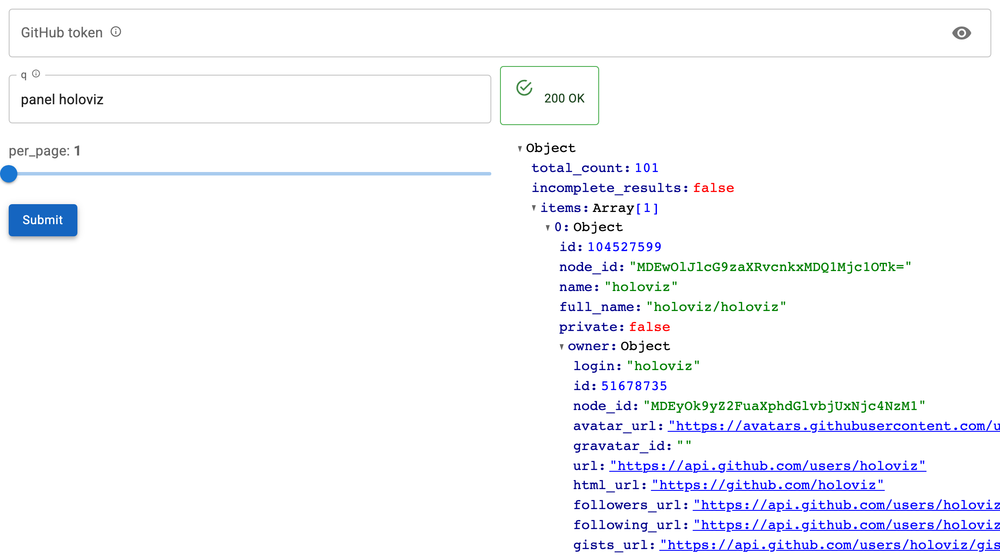

# Authenticate Requests

Pass a `headers` mapping and it is sent with every request.



## Static credentials

```python
from panel_openapi import OpenAPIForm

form = OpenAPIForm(
    spec,
    base_url="https://api.example.com",
    path="/things",
    method="get",
    headers={"Authorization": "Bearer s3cret", "Accept": "application/json"},
)
```

## Swapping credentials at runtime

The mapping is read on each submit, not copied at construction, so mutating it
takes effect on the next request without rebuilding the form:

```python
headers = {"Accept": "application/vnd.github+json"}
form = OpenAPIForm(spec, base_url=..., path=..., method="get", headers=headers)

def apply_token(event):
    if event.new:
        headers["Authorization"] = f"Bearer {event.new}"
    else:
        headers.pop("Authorization", None)

token = pmui.PasswordInput(label="Token")
token.param.watch(apply_token, "value")
```

A `PasswordInput` keeps the value out of the visible page. It still travels to
the Python process, which is where the request is made from, so a served app
should be over HTTPS if the token matters.

## Complete example

```python
--8<-- "docs/snippets/authentication.py"
```

## Header parameters in the document

When the document declares a header parameter, it gets a widget like any other
field, and the user fills it in:

```json
{
  "name": "X-API-Key",
  "in": "header",
  "required": true,
  "schema": {"type": "string", "format": "password"}
}
```

Use `format: password` and it becomes a `PasswordInput`.

Widget values win over the `headers` mapping where both set the same header.

## Per-user credentials

Panel runs a separate session per user, so build the form inside the app function
and keep the token in that session rather than at module level:

```python
def app():
    headers = {}                 # this session only
    form = OpenAPIForm(SPEC, base_url=..., path=..., method="get", headers=headers)
    ...
    return layout
```

A module-level dict is shared by every visitor, which is rarely what you want
for credentials.
