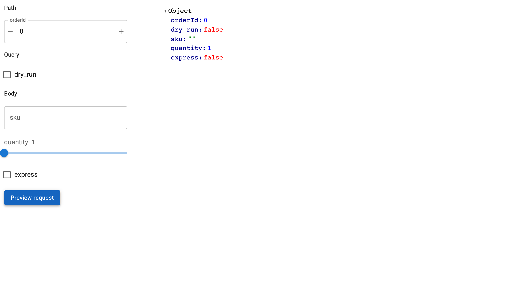

# Build Your Own Form

When you want validation, grouping or submit behaviour that `OpenAPIForm` does
not offer, the introspection it is built on is public. Use the helpers directly
and keep only the schema-reading part.



## The four helpers

```python
from panel_openapi import collect_fields, get_operation, load_openapi, schema_to_widget

openapi = load_openapi(spec)                            # parse and validate
operation = get_operation(openapi, "/orders/{orderId}", "put")   # one operation
fields = collect_fields(openapi, operation)             # flatten to fields
widget = schema_to_widget(field.name, field.schema, field.required)
```

`load_openapi` accepts a URL, dict or parsed model. `get_operation` raises
`KeyError` naming what is available when the path or method is not defined, and
merges in any parameters declared on the path item.

## What a Field carries

`collect_fields` flattens parameters and JSON body properties into one ordered
list, so you do not have to walk the document or resolve `$ref` yourself:

| Attribute | Meaning |
| --- | --- |
| `name` | The field name, and the key in the request |
| `location` | `"path"`, `"query"`, `"header"` or `"body"` |
| `schema` | The resolved schema, with `$ref` followed |
| `required` | Whether the operation requires it |
| `read_only` | Whether it is server-assigned, and so must not be sent |

Pass `skip_read_only=True` to drop read-only fields rather than have them
returned flagged.

## Complete example

Grouped by location, with a request preview instead of a request:

```python
--8<-- "docs/snippets/build_your_own.py"
```

## Choosing your own widgets

`schema_to_widget` is one field at a time, so you can override it selectively and
fall back for the rest:

```python
OVERRIDES = {"country": lambda field: pmui.AutocompleteInput(options=COUNTRIES, label="Country")}

for field in fields:
    build = OVERRIDES.get(field.name)
    widget = build(field) if build else schema_to_widget(field.name, field.schema, field.required)
```

Required fields are tagged on the widget, which is a convenient way to mark them
in your own validation:

```python
required = [w for w in widgets if "required" in w.tags]
```

## Reading the response schema

`response_schema` returns the schema of an operation's success response, which is
what tells you the shape of a record before you have fetched one:

```python
from panel_openapi import response_schema

schema = response_schema(openapi, get_operation(openapi, "/articles/{id}", "get"))
list(schema.properties)   # ["id", "created", "title", ...]
```

It prefers the lowest 2xx response, falling back to `default`, and reads the
first JSON media type it finds. It returns `None` when the operation documents no
JSON response.

## Building the request

If you assemble the request yourself, the grouping is what matters: `path` values
substitute into the templated path, `query` becomes the query string, `header`
merges into the headers, and `body` becomes the JSON body, except that a lone
field named `body` carries the whole payload.

Or keep `OpenAPIForm` for the request handling and only rearrange its widgets,
which is usually less work: see [Customize the Layout](custom-layout.md).
