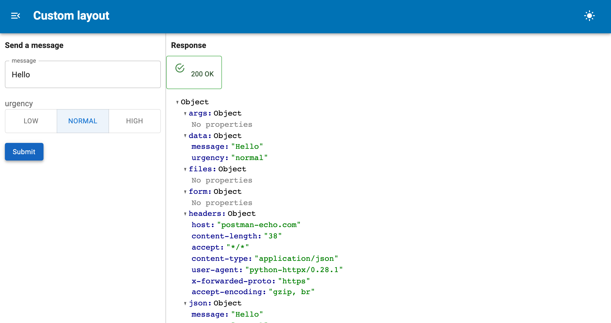

# Customize the Layout

`OpenAPIForm` renders as widgets beside the response by default. Both halves are
public Panel containers, so you can put them wherever you like.



## The two containers

| Attribute | Contents |
| --- | --- |
| `form.form` | The widgets and the submit button |
| `form.response` | The status and body of the latest response, empty until submit |

Both are `panel_material_ui.Column` instances. Place them independently:

```python
pmui.Page(
    title="My client",
    sidebar=[form.form],
    main=[form.response],
)
```

## Rebuilt in place

When the operation changes the containers are mutated, not replaced, so a layout
built once stays correct. Keep a reference to the container, not to its contents:

```python
layout = pmui.Column(form.form)   # fine, follows the operation
layout = pmui.Column(*form.form)  # stale after the next rebuild
```

## Complete example

```python
--8<-- "docs/snippets/custom_layout.py"
```

## Rearranging the widgets

`form.widgets` is keyed by name and `form.fields` carries each field's location,
so you can group them yourself and still get the form's submit behaviour:

```python
groups = {}
for field in form.fields:
    groups.setdefault(field.location, []).append(form.widgets[field.name])

pmui.Column(
    pmui.Typography("Parameters", variant="subtitle2"), *groups.get("query", []),
    pmui.Typography("Body", variant="subtitle2"), *groups.get("body", []),
)
```

The submit button lives in `form.form`. If you lay the widgets out yourself, add
your own button and await `form.submit()` from it:

```python
async def save(event):
    await form.submit()

pmui.Button(label="Send", variant="contained", on_click=save)
```

## Titles and headings

`form.title` is a parameter, so it can be passed as a reference and will follow
the operation:

```python
pmui.Typography(form.param.title, variant="h6")
```

## Several forms together

Tabs are a natural fit for one operation per tab:

```python
pmui.Tabs(
    ("Create", OpenAPIForm(spec, base_url=BASE, path="/tasks", method="post")),
    ("List", OpenAPIForm(spec, base_url=BASE, path="/tasks", method="get")),
    dynamic=True,
)
```

Parse the spec once with `load_openapi` and share it, rather than fetching the
same URL per form.

## Editor layout

`OpenAPIRecordEditor` exposes its two forms as `editor.lookup` and
`editor.editor`, each a full `OpenAPIForm` with its own `form` and `response`, so
the same rearranging applies:

```python
pmui.Row(record_editor.lookup.form, record_editor.editor.form)
```
