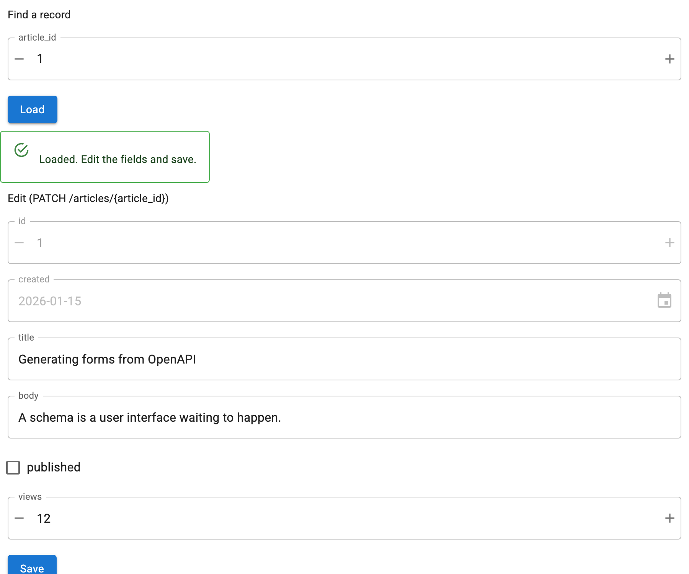

# Edit Records

`OpenAPIRecordEditor` covers the case a single form does not: fetch an existing
record, show it populated, and send the changes back. It pairs the read operation
on a path with the update operation on the same path.



## The minimum

```python
from panel_openapi import OpenAPIRecordEditor

editor = OpenAPIRecordEditor(
    spec,
    base_url="https://api.example.com",
    path="/articles/{article_id}",
)
```

That renders a lookup form for `GET /articles/{article_id}` with a **Load**
button, and below it an edit form for the update operation with a **Save**
button. Load fetches the record and populates the edit form; Save sends it back.

## Finding the update operation

The path is searched for an update operation, preferring `PATCH`, then `PUT`,
then `POST`. The read method is never treated as the update, even when the read
is itself a `POST`.

The resolved method is always displayed in the edit form's heading, because
`POST` on a path means "update this" in some APIs and "create a subresource" in
others, and a heuristic you cannot see is worse than none. Override it when the
guess is wrong:

```python
editor = OpenAPIRecordEditor(spec, base_url=..., path=..., update_method="put")
```

To check what is available before deciding:

```python
from panel_openapi import find_update_operations

find_update_operations(spec, "/articles/{article_id}")   # ["patch", "put"]
```

If there is none, `editor.editor` is `None` and the editor says so instead of
rendering a Save button that cannot work.

## What gets sent

This is the part worth being certain about:

- **`PATCH`** sends **only the fields that differ** from the loaded record. That
  is what a partial update means: an omitted key is left alone. If nothing
  differs, nothing is sent.
- **`PUT` and `POST`** send the full body, since they replace the resource.
- **`readOnly` fields** are never sent, under any method. They are shown disabled
  so you can see the `id` and the timestamps without being able to break them.

## Complete example

```python
--8<-- "docs/snippets/record_editor.py"
```

## Driving it from code

Set `show_lookup=False` to hide the lookup form and drive it yourself:

```python
editor = OpenAPIRecordEditor(spec, base_url=..., path=..., show_lookup=False)

record = await editor.load(article_id=1)     # fetch and populate
editor.editor.widgets["title"].value = "A new title"
saved = await editor.save()                  # returns the server's version
```

`load` raises `ValueError` for a lookup field the read operation does not
declare, rather than silently ignoring it. If you already have the record, skip
the fetch:

```python
editor.populate(record)
```

`populate` also sets the baseline that a `PATCH` diffs against.

## Inspecting pending changes

```python
editor.diff()
# {"title": ("Old title", "A new title")}
```

`diff` covers every editable location, not just the body, and reports `(old,
new)` per field. `editor.record` is the record as last loaded or saved, and
`editor.loaded` says whether there is one.

After a successful save the server's version of the record is adopted, so the
`PATCH` baseline stays accurate and any server-side changes become visible.

## Confirming before saving

`confirm=True` puts a dialog listing the pending changes in front of the save:

```python
editor = OpenAPIRecordEditor(spec, base_url=..., path=..., confirm=True)
```

Each change is shown as `old → new`, with the method and path that will be used.
Long values are truncated. Cancel sends nothing. Note that `save()` bypasses the
dialog, which is wired to the Save button, so calling it from code always saves.

## Save is enabled by an edit

Save starts disabled and enables as soon as a record is loaded or any editable
field is touched. Touching a `readOnly` field does not enable it, since that
cannot produce anything worth sending. Editing without loading first is allowed:
a `PATCH` of a couple of fields is perfectly valid without reading the record.

## Shared path parameters

Both operations sit on the same path, so both declare e.g. `article_id`. When the
lookup form is shown, the edit form's copy is hidden and the value is carried
across on save, rather than asking twice and letting the two disagree. With
`show_lookup=False` the edit form shows it, since nothing else would ask.

## Related

- [Read and Submit Values](values.md) for the underlying form API
- [`examples/08_patch_editor.py`](../examples.md) displays every `PATCH` body a
  local FastAPI app receives, which is the way to see the diff semantics for
  yourself
