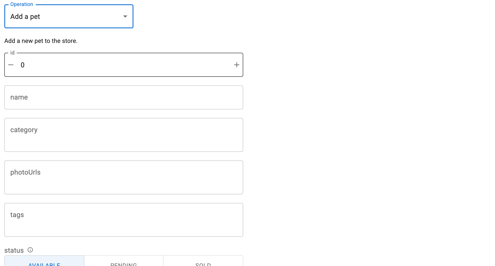

# Switch Operations

`path`, `method` and `base_url` are parameters, so one form can serve any
operation in the document it was constructed with. Setting `path` or `method`
rebuilds the widgets; setting `base_url` redirects the next request.



## Change both at once

```python
form.param.update(path="/pet", method="post")
```

Use `param.update` rather than two assignments. Two assignments rebuild twice,
and the intermediate pair, e.g. the old path with the new method, is often an
operation the document does not define, which renders an error on the way past.

## Rebuilt in place

`form.form` and `form.response` are the same objects before and after, mutated
rather than replaced, so a layout built once keeps working:

```python
layout = pmui.Column(form.form)   # built once
form.method = "post"              # layout now shows the POST widgets
```

The previous response is cleared on rebuild, since it does not describe the new
operation.

## A selector over several operations

```python
--8<-- "docs/snippets/switch_operation.py"
```

## Undefined targets

Setting a path or method the document does not define renders an error listing
what is available, and leaves `form.widgets` empty. Setting a valid one restores
the form, so a selector that passes through an invalid combination recovers.

## Redirecting requests

`base_url` is read when the request is built, so pointing a form at staging
instead of production needs nothing else:

```python
form.base_url = "https://staging.example.com"
```

## Reacting to changes

`title` updates with the operation unless you set it explicitly, and it is a
parameter, so it can drive a heading:

```python
pmui.Typography(form.param.title, variant="h6")
```

`pmui.Page.title` is a plain string parameter and cannot take a reference, so
sync it with a watcher instead:

```python
form.param.watch(lambda event: setattr(page, "title", event.new), "title")
```
