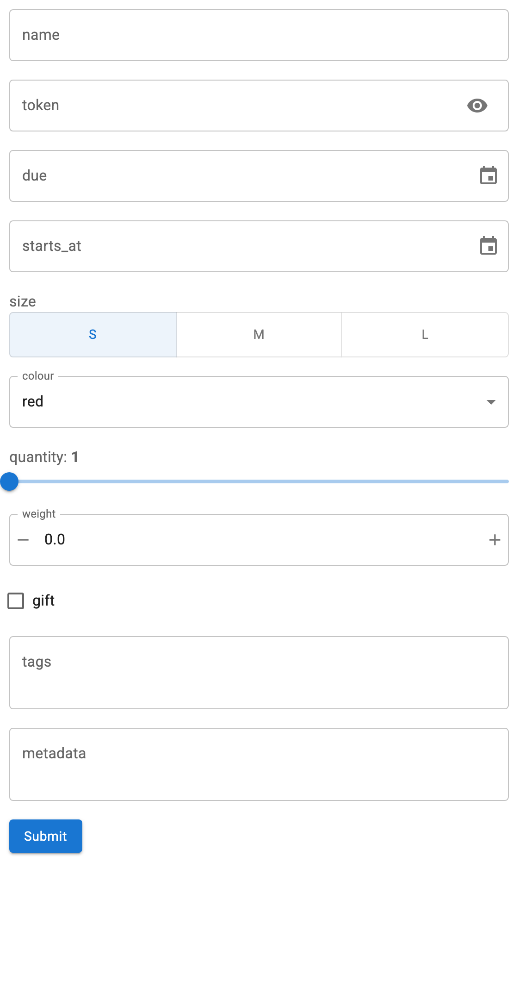

# Understand Widget Mapping

Every widget is chosen from the field's schema. The rules below are the whole of
it, so you can predict what a form will look like by reading the document, and
adjust the document when you want something different.



## The rules

Applied in order; the first match wins.

| Schema | Widget |
| --- | --- |
| `enum` with 3 or fewer values | `RadioButtonGroup` |
| `enum` with more than 3 values | `Select` |
| `string`, `format: password` | `PasswordInput` |
| `string`, `format: date` | `DatePicker` |
| `string`, `format: date-time` | `DatetimePicker` |
| `string` | `TextInput` |
| `integer` with both `minimum` and `maximum` | `IntSlider` |
| `integer` with one bound or none | `IntInput` |
| `number` with both `minimum` and `maximum` | `FloatSlider` |
| `number` with one bound or none | `FloatInput` |
| `boolean` | `Checkbox` |
| `array` whose `items` have an `enum` | `MultiChoice` |
| Anything else, including `object` and free-form arrays | `TextAreaInput` holding JSON |

`enum` is checked before `type`, so an enum of integers still gets a
`RadioButtonGroup` or `Select`.

## A form showing all of them

```python
--8<-- "docs/snippets/widget_mapping.py"
```

## What carries over from the schema

- **`title`** becomes the widget label, falling back to the field name.
- **`description`** becomes the widget's description, shown as a tooltip. For a
  parameter this is read from the parameter itself, which is where OpenAPI puts
  it; for a body property, from its schema.
- **`default`** becomes the initial value.
- **`minimum`/`maximum`** bound the numeric widgets, and decide slider or spinner.
- **`required`** is recorded on the widget's `tags`, and drives submit validation.
- **`readOnly`** disables the widget and excludes the field from the request.

## Nullable fields

An optional value is often written as a union with null, which would otherwise
land in the "anything else" row and get a JSON text area. A union with exactly one
non-null branch is unwrapped to that branch, so it gets a real widget:

```python
# OpenAPI 3.1, and what pydantic emits for `str | None`
{"anyOf": [{"type": "string"}, {"type": "null"}]}   # -> TextInput

# OpenAPI 3.0
{"type": "string", "nullable": True}                # -> TextInput

# A genuine union is left alone
{"anyOf": [{"type": "string"}, {"type": "integer"}]}  # -> JSON TextAreaInput
```

This matters most for `PATCH` request models, where nearly every field is
optional.

## Free-form arrays

An array of arbitrary strings becomes a JSON text area rather than a
`MultiChoice`, because `MultiChoice` cannot accept a value outside its options.
Give `items` an `enum` when you want the picker:

```python
# JSON text area: type ["a", "b"] yourself
{"type": "array", "items": {"type": "string"}}

# MultiChoice with two options
{"type": "array", "items": {"type": "string", "enum": ["new", "sale"]}}
```

JSON text areas are parsed on submit. Invalid JSON is reported and nothing is
sent.

## Changing what you get

The widget follows the schema, so the way to change the widget is to change the
schema, e.g. adding `format: date` to a string or bounds to an integer. When the
document is not yours to change, or you want something the mapping does not
offer, [build the form yourself](build-your-own.md); `schema_to_widget` is public
and usable field by field.
