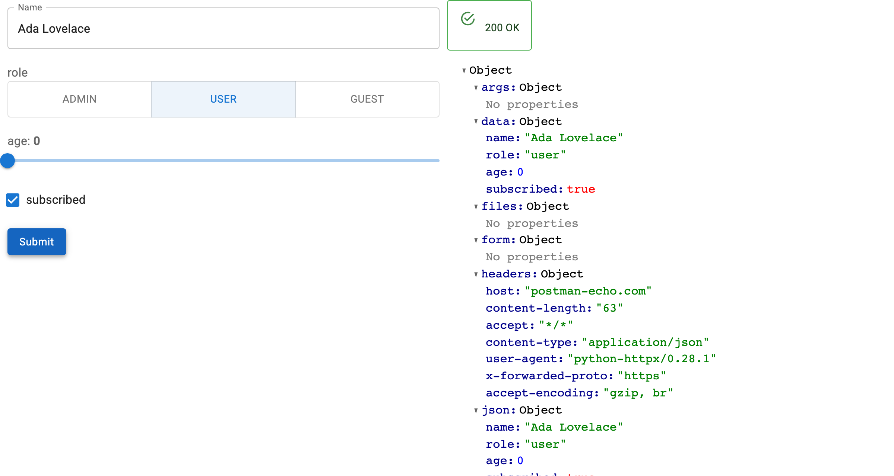

# :material-api: Turn an OpenAPI Schema into a Working UI

**panel-openapi reads an OpenAPI document and builds a Panel form for any**
**operation in it: a widget per parameter, a request on submit, the response rendered.**

Point it at a spec, a path and a method. It works out the inputs from the
schema, so there is no form to write, no request to assemble, and nothing to
keep in sync when the API changes.



!!! tip "Two minutes to a working form"
    New here? **[Start with the quickstart →](quickstart.md)**

## Why panel-openapi

- **No form code**: every path, query, header and body field becomes a widget.
- **Any spec source**: a URL, a dict, or a FastAPI app's `api.openapi()`.
- **Real requests**: submit issues the call and renders the response.
- **Reactive targeting**: set `path` or `method` and the form rebuilds itself.
- **Record editing**: [`OpenAPIRecordEditor`](how-to/edit-records.md) loads a
  record from a `GET` and sends the changes to the matching `PATCH`/`PUT`/`POST`.
- **Yours to rearrange**: `form` and `response` are plain Panel containers, and
  the introspection helpers are public if you would rather build it yourself.

## Quickstart

```python
import panel as pn

from panel_openapi import OpenAPIForm

pn.extension()

form = OpenAPIForm(
    "https://petstore3.swagger.io/api/v3/openapi.json",
    base_url="https://petstore3.swagger.io/api/v3",
    path="/pet/{petId}",
    method="get",
)

form.servable()
```

```bash
panel serve app.py --show
```

## How-to guides

- [Build a Form](how-to/build-a-form.md) — the three things `OpenAPIForm` needs
- [Load a Specification](how-to/load-a-spec.md) — URL, dict, or a live FastAPI app
- [Understand Widget Mapping](how-to/widget-mapping.md) — which schema makes which widget
- [Switch Operations](how-to/switch-operations.md) — one form, any operation
- [Authenticate Requests](how-to/authenticate.md) — headers, and swapping them at runtime
- [Read and Submit Values](how-to/values.md) — inspect, populate and submit from code
- [Edit Records](how-to/edit-records.md) — load a record, edit it, send it back
- [Customize the Layout](how-to/custom-layout.md) — place `form` and `response` yourself
- [Build Your Own Form](how-to/build-your-own.md) — use the introspection helpers directly

## Examples

- [Examples gallery](examples.md) — the runnable scripts in `examples/`

## Reference

- [API reference](reference/panel_openapi.md)
