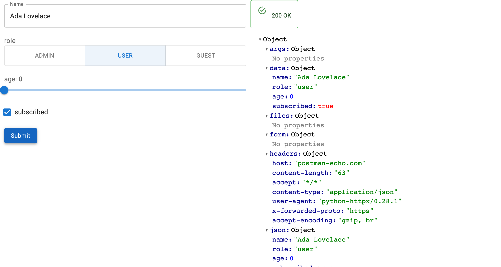

# Quickstart

Build a working form for one API operation. By the end of this page you will
have a form whose widgets came from a schema, and which issues a real request
when you submit it.



## Install

```bash
pip install panel-openapi
```

## Minimal app

`OpenAPIForm` needs three things: a specification, a base URL, and the operation
to target as a path and method.

```python
--8<-- "docs/snippets/quickstart.py"
```

## Run

```bash
panel serve app.py --show
```

Fill in `Name` and press Submit. The form issues the `POST`, and the response
appears beside it.

## What the schema decided

Nothing above says which widget to use. Each one came from the schema:

| Property | Schema | Widget |
| --- | --- | --- |
| `name` | `{"type": "string"}`, and in `required` | `TextInput`, empty submit is refused |
| `role` | `enum` of three values | `RadioButtonGroup` |
| `age` | `integer` with `minimum` and `maximum` | `IntSlider` |
| `subscribed` | `{"type": "boolean", "default": true}` | `Checkbox`, checked |

[The full mapping is documented separately →](how-to/widget-mapping.md)

## Point it at a real spec

An inline dict keeps the example self-contained, but a URL works just as well:

```python
form = OpenAPIForm(
    "https://petstore3.swagger.io/api/v3/openapi.json",
    base_url="https://petstore3.swagger.io/api/v3",
    path="/pet/{petId}",
    method="get",
)
```

## Next steps

- [Build a Form](how-to/build-a-form.md) covers required fields, JSON bodies and errors.
- [Load a Specification](how-to/load-a-spec.md) covers FastAPI apps and remote specs.
- [Edit Records](how-to/edit-records.md) goes from submitting a form to editing a record.
